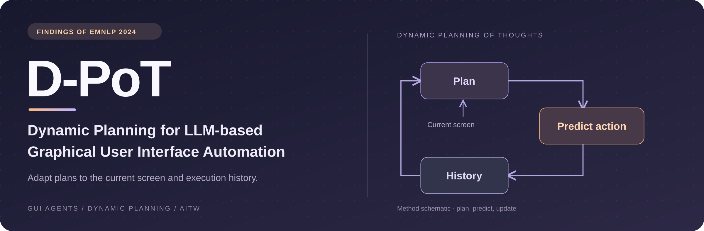
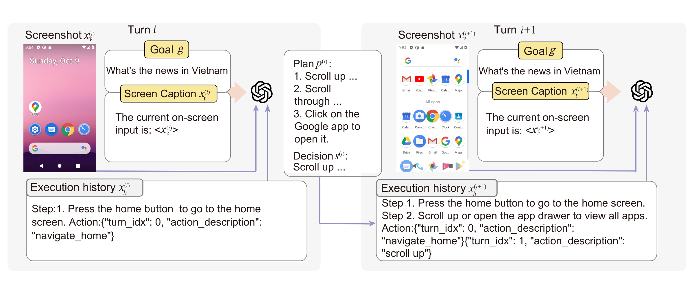

# D-PoT

**Dynamic Planning for LLM-based Graphical User Interface Automation**  
**Findings of EMNLP 2024** · Dynamic Planning of Thoughts

Shaoqing Zhang, Zhuosheng Zhang, Kehai Chen, Xinbei Ma, Muyun Yang, Tiejun Zhao, Min Zhang

**[Paper](https://aclanthology.org/2024.findings-emnlp.70/)** · **[PDF](https://aclanthology.org/2024.findings-emnlp.70.pdf)** · **[arXiv](https://arxiv.org/abs/2410.00467)** · **[Citation](#citation)**

[Overview](#overview) · [Method](#method) · [Results](#results) · [Getting started](#getting-started) · [Evaluation](#evaluation) · [Code map](#code-map)

---

## Overview

**Plan for the screen in front of you.** D-PoT equips a GUI agent with a plan that evolves as interaction progresses. At each turn, it uses the current screenshot, screen description, task goal, and execution history to revise the plan and predict the next action.

| Dynamic planning | Action prediction | Execution history |
| :--- | :--- | :--- |
| Update the remaining plan using the current interface. | Select the immediate step and translate it into a GUI action. | Carry previous steps and actions into the next planning turn. |

This repository contains the research implementation and evaluation scripts for the paper, including a GPT-4V prompting workflow and LLaVA-based training utilities.

## Method



*Figure 3 from the paper. The goal, screenshot, screen description, and execution history guide planning at each turn.*

[Full-resolution figure](./assets/paper-framework.png) · [Original figure PDF](./assets/paper-framework.pdf) · [Conceptual planning loop — Figure 1](./assets/paper-planning.png)

The main inference script makes two model calls per step: one to produce a plan and select its immediate step, and another to predict the action. It then adds that step and action to the execution history. The released evaluation workflow processes recorded AITW screenshots.

## Results

Selected results from **Table 3** of the [paper](https://aclanthology.org/2024.findings-emnlp.70.pdf). The metric is the screen-wise action-matching score (%), rather than end-to-end task success. The evaluation samples 60 episodes from each of the five AITW subsets.

| Method | Overall | General | GoogleApps | Install | Single | WebShopping |
| :--- | ---: | ---: | ---: | ---: | ---: | ---: |
| GPT-4V zero-shot | 34.66 | 29.69 | 35.75 | 43.50 | 32.95 | 31.42 |
| GPT-4V ReAct | 42.73 | 36.20 | 42.49 | 46.60 | 49.13 | 39.22 |
| D-PoT | 46.47 | 40.10 | 49.74 | 47.18 | 58.96 | 36.34 |
| D-PoT w/ reference | **47.36** | 42.19 | 49.48 | 49.61 | 58.96 | 36.55 |

**D-PoT improves Overall by 11.81 percentage points over GPT-4V zero-shot; D-PoT w/ reference improves it by 12.70 points.** The reference variant additionally uses similar task goals during planning initialization (Section 5.5). These are reported paper results, not measurements from running this repository snapshot.

## Getting started

### 1. Prepare AITW data

Follow the train/test split of [Android in the Wild (AITW)](https://github.com/google-research/google-research/tree/master/android_in_the_wild), and sample test trajectories for the desired subsets.

Use `fetch_feature.py` and `utils_data.py` from [Auto-GUI](https://github.com/cooelf/Auto-GUI) to prepare screen-parsing features, as in the original repository workflow. The local [`load_data`](./utils_data.py) function converts parsed episodes into source prompts and target actions. Save those returned records as the corresponding JSON inputs.

The main script uses `web_shopping` by default and expects:

| Input | Location |
| :--- | :--- |
| Episode prompts | `new_sample_test/test/<dataset>_test_source.json` |
| Screenshot at a step | `new_ImageDataset/<dataset>_ScreenImg/<episode_id>/step <step_id>.png` |
| Planning and action prompts | [`prompt/prompts2.json`](./prompt/prompts2.json) |

Each source record has an `episode_id` and a `data` mapping from step IDs to prompt strings. Each prompt includes `Goal: ...` followed by a newline and `Screen: ...`, as produced by `load_data`.

### 2. Configure the experiment

Run commands from the repository root. For the GPT prompting and action-evaluation path, the directly imported external packages include:

```bash
pip install openai requests tqdm numpy jax
```

Data preparation through `utils_data.py` additionally imports PyTorch. The LLaVA training path has a separate environment and model requirements; see [optional training utilities](#optional-training-utilities). This snapshot does not provide a pinned dependency lockfile.

Update the following settings in [`prompt_D-PoT_gpt4v.py`](./prompt_D-PoT_gpt4v.py) for your environment:

| Setting | What to configure |
| :--- | :--- |
| `dataset_name` | The same subset name used for your prepared data and screenshots. |
| `OpenAI(...)` client | Your API credentials and service configuration. |
| Model identifier | Both planning and action calls use `gpt-4-vision-preview` in this snapshot; select an accessible vision-capable model for a new run and record the change when comparing results. |
| Proxy settings | The script sets HTTP/HTTPS proxies to `127.0.0.1:7890`; adjust or remove these assignments for your environment. |
| Input paths | The source JSON and screenshot directories listed above. |

### 3. Generate predictions

```bash
python prompt_D-PoT_gpt4v.py
```

The script writes these artifacts for the selected dataset:

| Output | Location |
| :--- | :--- |
| Predicted actions | `test/action/<dataset>_DPAgent_action.json` |
| Plans and selected steps | `test/plan/<dataset>_DPAgent_plan.json` |
| Step inputs | `test/step_input/<dataset>_DPAgent_new_step_input.json` |

## Evaluation

### 1. Extract structured actions

The example below follows the inference script's default `web_shopping` subset. Prepare the parsed episode records and target actions for the same episodes, keeping their order consistent with the predictions.

```bash
mkdir -p result/action result/metrics

python extract_action.py \
  --predict_dir test/action/web_shopping_DPAgent_action.json \
  --parsed_dir parsed_json/web_shopping_parsed_episode_sample.json \
  --output_dir result/action/web_shopping_DPAgent_action_ex.json
```

[`extract_action.py`](./extract_action.py) reads model responses and resolves click indices using the UI positions in the parsed episodes.

### 2. Score predictions against targets

```bash
python eval.py \
  --predict_dir result/action/web_shopping_DPAgent_action_ex.json \
  --golden_dir sample_test/web_shopping_test_target.json \
  --threshold 0.14 \
  --output_dir result/metrics/web_shopping_metrics.json
```

The example uses the `0.14` threshold from the supplied evaluation shell script. [`eval.py`](./eval.py) computes action-matching metrics against the target records.

The original shell entry points are also available:

```bash
bash extract_action.sh
bash eval.sh
```

Before using those wrappers, update their subset names and file paths: both currently select `install` and refer to `SeAAgent` filenames, while the main prediction script defaults to `web_shopping` and writes `DPAgent` filenames.

## Code map

| File or directory | Purpose |
| :--- | :--- |
| [`prompt_D-PoT_gpt4v.py`](./prompt_D-PoT_gpt4v.py) | Dynamic planning, immediate-step selection, and action prediction. |
| [`prompt_baseline.py`](./prompt_baseline.py) | Baseline prompting workflow. |
| [`prompt/prompts2.json`](./prompt/prompts2.json) | Planning and action prompt templates. |
| [`utils_data.py`](./utils_data.py) | Prepare source prompts and target actions from parsed episodes. |
| [`extract_action.py`](./extract_action.py) | Convert generated responses into structured actions. |
| [`eval.py`](./eval.py) | Evaluate predictions against target actions. |
| [`action_matching.py`](./action_matching.py) | Action-matching utilities. |
| [`action_type.py`](./action_type.py) | Action-type definitions. |
| [`llava/`](./llava/) | LLaVA model, training, and inference code. |
| [`scripts/`](./scripts/) | Training, evaluation, and data-conversion scripts. |
| [`assets/`](./assets/) | README visuals and original paper figures. |

## Optional training utilities

The repository also includes a LLaVA fine-tuning path. [`scripts/finetune.sh`](./scripts/finetune.sh) configures DeepSpeed training; [`scripts/eval.sh`](./scripts/eval.sh) runs the associated AITW inference script. Update their checkpoint, vision encoder, projector, data, and GPU settings before use. Model checkpoints and dataset files must be supplied separately.

## Acknowledgments

This work uses [Android in the Wild](https://github.com/google-research/google-research/tree/master/android_in_the_wild) and builds on the screen-processing workflow of [Auto-GUI](https://github.com/cooelf/Auto-GUI). The repository also includes [LLaVA](https://github.com/haotian-liu/LLaVA)-based code for the fine-tuning experiments. Paper figure sources are documented in [`assets/README.md`](./assets/README.md).

## Citation

If you use D-PoT in your research, please cite the published paper:

```bibtex
@inproceedings{zhang2024dynamic,
  title={Dynamic planning for llm-based graphical user interface automation},
  author={Zhang, Shaoqing and Zhang, Zhuosheng and Chen, Kehai and Ma, Xinbei and Yang, Muyun and Zhao, Tiejun and Zhang, Min},
  booktitle={Findings of the Association for Computational Linguistics: EMNLP 2024},
  pages={1304--1320},
  year={2024}
}
```

[Back to top](#d-pot)
